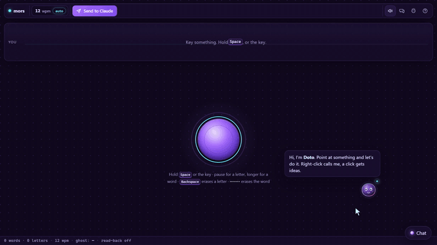
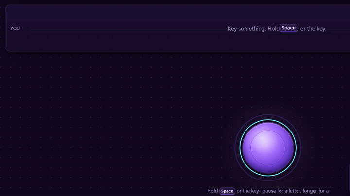
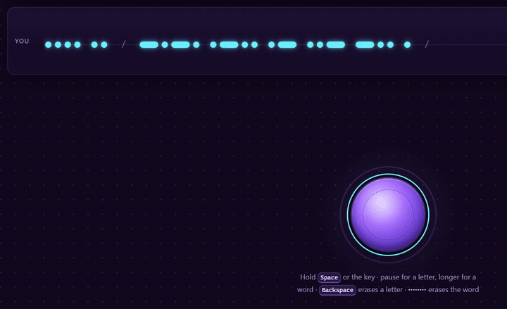

<p align="center"></p>

<p align="center">
  <a href="https://github.com/offensiveadhd/lets-unique-mors/actions/workflows/validate.yml"></a>
  
  
  <a href="LICENSE"></a>
</p>

<p align="center"><b>Talk in Morse.</b><br>A <a href="https://github.com/offensiveadhd/lets">lets</a> unique: one key, one tape. Key your message in dots and dashes and send it to Claude, who reads it as a prompt and does what it says. The window assumes you know Morse. Only Doto helps you craft the message, and Claude can answer in Morse on the tape.</p>

<p align="center">
  <a href="#see-it-run">See it run</a> ·
  <a href="#install">Install</a> ·
  <a href="#what-you-can-do">What you can do</a> ·
  <a href="#rules-of-the-road">Rules of the road</a> ·
  <a href="#how-claude-drives-it">How Claude drives it</a> ·
  <a href="#layout">Layout</a> ·
  <a href="#develop">Develop</a>
</p>

## See it run

<p align="center">
  <a href="assets/demo.mp4"></a>
</p>

One real take of the mors window on a real lets host, recorded in a headless browser. The dots and dashes
are Space key events fired inside the page on a timer, at the window's starting speed of 12 wpm, because
Morse needs steadier timing than a remote-controlled browser gives. The pointer, the typing and the Tab
keys go through the browser's own input. Claude's side (the ghost, Doto's lines, the Morse reply) is sent
through the engine's own tools by a script written ahead. The browser is muted, so the film has no tones.
Select the picture for the [full take](assets/demo.mp4). How it was recorded is in
[lets/promo](https://github.com/offensiveadhd/lets/tree/main/promo).

## Install

mors is installed from the store. It is not a default.

```
/lets store mors      # inspect → confirm
/lets:lets mors       # or /lets mors with the alias
```

Manual: clone this repo into `~/.lets/uniques/mors`, or set `LETS_UNIQUES_DIRS=<parent folder>` while developing. mors needs lets 0.4.0 or later (handoff sessions). It asks for no files and no network: the manifest declares `fs.write: []` and `net: []`.

## What you can do

<p align="center">
  
</p>

| part | what it does |
|---|---|
| **Key** | A round knob, and the lamp above it. Hold the key or hold `Space`: a press shorter than 2 units is a dot, a longer one is a dash. The lamp lights and a tone sounds while you press. With `auto` on, the unit follows your hand, and the wpm chip in the toolbar shows the speed (12 wpm to start). Typed `.`, `-` and `_` add an element without a press, and `/` forces a word gap. |
| **Tape** | Your message as it grows: dots are glowing discs, dashes are glowing bars. After 2.2 units of silence the letter closes, after 5.5 the word closes and Claude hears about it. `Backspace` erases the last element or letter, `Ctrl+Backspace` the last word, `Ctrl+Z` undoes the last erase, insert or clear. Eight dots in one group (`........`) is the error prosign: it erases the word you were keying. |
| **Read-back** | Doto's *Read it back*. Off by default. It shows the decoded character above each letter group and a readout line under the tape. *Check what I keyed* asks Claude to read your tape and say what it sees. |
| **Ghost** | Doto's *Spell a word for me*. You type the words, Claude shows the letters dim after your message, each pattern with its character above. You key them: a matching letter lights and the ghost shrinks. `Tab` keys the next letter for you, `Shift+Tab` the rest, `Esc` dismisses. A letter that does not match drops the ghost. |
| **Chart** | Doto's *Show the chart*. The alphabet, the digits, the punctuation and the prosigns in one overlay. With the full controller on, each entry is a button that keys it. `Esc` closes it. |
| **Full controller** | Doto's *Full controller*. A panel with the readout, a **Say it** box (type words, `Enter` keys them at the current speed), a grid of letter buttons, **Undo letter**, **Clear**, a speed slider (3 to 30 wpm) with **auto**, **sound**, **Chart**, and an **Ask** box for a plain question to Claude. Below 700 px tall it is a bottom drawer. |
| **Claude's reply track** | Claude can talk back. A second track under yours: the lamp blinks magenta, a lower tone sounds, and the symbols appear as they play. Plays queue. Your key stays live while Doto is keying. |
| **Send to Claude** | Hands the message over as a prompt (`Ctrl+Enter`). Claude says in one line what it read, then does what the message asks, in Claude Code. End with `AR` (end of message), `SK` (end of contact) or a word `K` (over) and the button glows and takes the next `Enter`. Nothing is sent by itself. Say *continue* to bring the window back with your message and Claude's track. |

Timing is counted in units: a dot is 1, a dash 3, the gap inside a letter 1, between letters 3, between words 7. A unit starts at 100 ms (12 wpm) and stays between 40 and 400 ms (30 to 3 wpm).

<details>
<summary>Every key</summary>

Everything is reachable with Tab, every control has a name, and `?` lists the shortcuts. `Space` is the key, `M` toggles sound, `Esc` closes the innermost open thing, `Ctrl+Enter` sends. While a ghost shows, `Tab` keys it instead of moving focus: press `Esc` first to move on.

These work outside text fields:

| key | does |
|---|---|
| `Space` (hold) | the key |
| `.` `-` `_` | a typed dot or dash |
| `/` | a word gap (typed input) |
| `Backspace` / `Ctrl+Backspace` | erase the last element or letter / the last word |
| `Tab` / `Shift+Tab` (with a ghost) | key the ghost's next letter / the rest of it; without a ghost Tab moves focus as usual |
| `Esc` | dismiss the ghost; then close the innermost open thing (help, the chart, the spell box); then stop an assisted keying |
| `Enter` (Send armed by `AR`, `SK` or `K`) | Send to Claude |
| `Ctrl+Enter` | Send to Claude |
| `Ctrl+Z` | undo the last erase, insert or clear |
| `M` | sound on / off |
| `?` | shortcuts |
| `Ctrl+/`, `Ctrl+Space`, right-click | the shell: chat, your companion |

The key is a real button, so `Enter` on it keys a dot.

</details>

### Claude answers on the tape

<p align="center">
  
</p>

Claude talks Morse back with `mors.play`. The lamp blinks magenta, the tone is lower than yours (520 Hz against your 700 Hz), and the symbols land on a second track under your message, with their characters when read-back is on. Claude keeps a play short, 20 characters at most: `R` for received, `K` for over, `73` for best regards, `SK` for end of contact. A whole answer never goes on the tape: it goes to chat or to Claude Code. When a play ends the window tells Claude with `mors.played`, and Doto nods.

### Rules of the road

- The window assumes you know Morse. By default it shows the key, the tape and Send, nothing else: no alphabet, no translation. Only Doto helps, and his extras (read-back, chart, full controller) stay hidden until you open them from his menu. Each one is remembered for the next window.
- A ghost is an offer. It is not in your message until you key it. A reject tells Claude to leave it alone.
- Your hand, your message. Claude appends or erases only when you ask, and `Ctrl+Z` takes it back.
- mors stores nothing on the host. The message lives in the window, in a saved session after *Send to Claude*, and in `sessionStorage` for this tab so a reload keeps it. Your preferences (sound, speed, auto, extras) sit in `localStorage`.
- Without a host, keying, read-back, the chart and the full controller still work. Send, Ask and the ghost need a host.
- If Claude is not listening, Send still exports, and the window says Doto is away. Claude picks it up with your next message in Claude Code.

## How Claude drives it

<p align="center"></p>

Events (up): `mors.changed`, `mors.ghost.accept|reject`, `mors.ask`, `mors.mode`, `mors.played`, `mors.export`, `mors.snapshot`.
Commands (down): `mors.suggest`, `mors.play`, `mors.insert`, `mors.erase`, `mors.reveal`, `mors.set`, `mors.load`, `mors.snapshot`.

The film above, as messages:

1. You key HI. When the word closes, `mors.changed` goes up with `text: "HI"`. Claude stays silent: the tape is your draft.
2. You pick *Spell a word for me* and type `Claude`. `mors.ask {kind: "spell", question: "Claude"}` goes up.
3. Claude sends `mors.suggest {rev, text: "CLAUDE", reason: "spell"}`, the ghost, and Doto says one line: "Spelled *CLAUDE*. Key it, or Tab."
4. You key C and L, `Tab` keys A and `Shift+Tab` the rest. `mors.ghost.accept {text: "CLAUDE", assisted: 4}` goes up, then `mors.changed` with `text: "HI CLAUDE"`.
5. Claude sends `mors.play {id: "p1", text: "HI"}`. The window answers `mors.played` when the lamp stops.
6. You press **Send to Claude**. `mors.export` goes up with `text: "HI CLAUDE"` and `reply: ".... .."`, the engine saves the session and the window closes.

<details>
<summary>Every event and command</summary>

Events, from the window to Claude:

| event | data | when |
|---|---|---|
| `mors.changed` | `{rev, morse, text, letters, words, wpm, unit, view, by, delta?}` | A word closed, an erase, a clear, or a command or a restore changed the message. Settled message only, never while a letter is open. `by` is `human`, `claude` or `restore`. |
| `mors.ghost.accept` | `{rev, text, assisted}` | You keyed the whole ghost. `assisted` counts the letters `Tab` keyed for you. |
| `mors.ghost.reject` | `{rev, reason, keyed}` | The ghost was dropped: `esc`, `keyed-away` or `cleared`. `keyed` is how many letters had matched. |
| `mors.ask` | `{kind, question, morse, text, rev, view, source}` | You asked Doto for help: `spell`, `check`, or `free` from the full controller's Ask box. |
| `mors.mode` | `{view, by}` | One of Doto's extras opened or closed: the full controller, the read-back or the chart. |
| `mors.played` | `{id, morse, ms}` | A `mors.play` finished. |
| `mors.export` | `{label, morse, text, letters, words, wpm, view, reply, ends?, stats}` | **Send to Claude**: a handoff. `ends` is `AR`, `SK` or `K` when the message ends with that sign. |
| `mors.snapshot` | the export payload | The reply to the `mors.snapshot` command. |

Commands, from Claude to the window:

| command | data | effect |
|---|---|---|
| `mors.suggest` | `{rev, text, reason?}` | The ghost: up to 60 characters for you to key next. `""` clears. |
| `mors.play` | `{id?, text?, morse?, wpm?, silent?}` | Claude talks Morse on the reply track. Plays queue, `{text: ""}` stops, and each one ends with `mors.played`. |
| `mors.insert` | `{text?, morse?, play?}` | Appends to your message, keyed at the current speed unless `play: false`. Undoable. |
| `mors.erase` | `{letters?, words?, all?}` | Removes from the end. Undoable. |
| `mors.reveal` | `{controller?, readback?, chart?}` | Doto's extras, from Claude's side. Only the keys given change. |
| `mors.set` | `{wpm?, unit?, auto?, sound?}` | Speed (3 to 30 wpm, or a unit of 40 to 400 ms), whether the unit follows your hand, the tone on or off. |
| `mors.load` | `{morse, wpm?, view?, reply?, ghost?}` | The restore command: brings back a saved message and Claude's track. |
| `mors.snapshot` | `{}` | Asks the window for its state. |

Every command accepts `"ack": true`.

</details>

The manifest's `session` block (`export: mors.export`, `snapshot: mors.snapshot`, `restore: mors.load`) lets the engine save a handoff and resume it.

- [GUIDE.md](GUIDE.md) is what Claude reads when it opens mors: how to decode a message, the help Doto asks for, talking Morse back, how to read a handoff, the etiquette.
- [CONTRACT.md](CONTRACT.md) is the behaviour spec: the model, every event and command with its data, the flows, the page and the sound.
- `schemas/` holds JSON Schemas for the main messages: `changed`, `ask`, `export`, `suggest`, `play` and `load`.

## Layout

```
unique.json    LIP manifest (name, entry, domains, events, commands, session, permissions)
GUIDE.md       instructions for Claude
CONTRACT.md    behaviour spec
icon.svg
assets/        what this README shows: banner.svg, flow.svg, demo.gif, demo.mp4, key.gif, reply.gif
schemas/       changed, ask, export, suggest, play, load; unique.schema.json (vendored)
ui/            index.html, mors.js (the window), morse.js (table, encode, decode, keyer state machine, timing),
               style.css
scripts/       validate.mjs: manifest + schema check (zero dependencies)
```

The UI uses the engine's shell at runtime (`/sdk/`). It has no build step and no dependencies. The tone is made in the browser with Web Audio, and the window never decides what your message means: Claude does that.

## Develop

```bash
# from a lets checkout; the registry looks for <dir>/mors/unique.json,
# so point it at the PARENT of a folder named "mors" (symlink or junction this repo there)
LETS_UNIQUES_DIRS=/path/to/parent node engine/bin/lets.mjs serve --open mors --verbose

node engine/bin/lets.mjs send mors.suggest '{"rev":1,"text":"HELLO"}'   # drive it from the CLI
node engine/bin/lets.mjs events                                         # drain what mors emitted
```

Validate with `node scripts/validate.mjs` here, or `node engine/bin/lets.mjs validate <this folder>` from the engine.

## License

MIT © offensiveadhd
